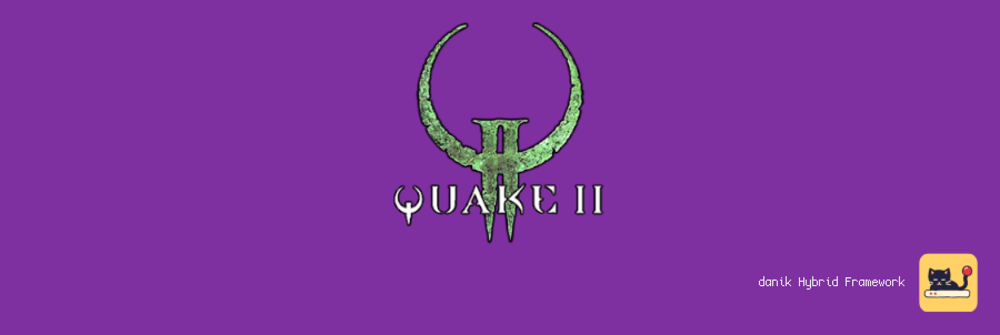

# YQuake2 for MiSTer

Quake II on [MiSTer FPGA](https://github.com/MiSTer-devel/Main_MiSTer/wiki) as a hybrid port.

The game is [Yamagi Quake II](https://www.yamagi.org/quake2/) ([GitHub](https://github.com/yquake2/yquake2)), the source port of id Software's Quake II that stays closest to the original, with its software renderer. The mission packs *The Reckoning* and *Ground Zero* are supported as well. It runs on the MiSTer's ARM CPU. The YQuake2 FPGA core provides native 15kHz video (CRT, VGA and HDMI) at 320x200 or 320x240, 44.1kHz audio and keyboard, mouse and gamepad input. The two halves talk through shared DDR3 memory.

> **Beta.** Expect rough edges and please report problems in the issues.
>
> **Disclaimer:** AI is being extensively used to speed up development, but the project is well-maintained and supported.

  
  

## Requirements

- **danik_hybrid_ports**, the launcher: run it **once** from the MiSTer's `Scripts` menu ([The launcher](#the-launcher)). Without it the core says "Game not running".
- **Game data**, which is not included: Quake II from the CD (patched to 3.20), Steam or GOG, or the free demo. The original game files, not those of the 2023 remaster.
- **Recommended:** a gamepad with two analog sticks and analog triggers, like an Xbox or PlayStation controller. A gamepad without them works but is not recommended. The game can also be played with a keyboard and mouse.

## Installation

With `update_all` (Downloader 2.4 or newer, which update_all keeps up to date):

1. Copy [`downloader_danik_hybrid_ports.ini`](https://raw.githubusercontent.com/ItsDanik/Hybrid_MiSTer/main/launcher/downloader_danik_hybrid_ports.ini) to the root of your SD card (`/media/fat`).
2. Run `update_all`. That installs the launcher, **danik_hybrid_ports**, in `Scripts`.
3. Run **danik_hybrid_ports** from the `Scripts` menu, tick the games you want and press *X: Apply*. They are installed, and update_all keeps them up to date.
4. Copy **everything** in your game's folders to `/media/fat/games/dnk/YQuake2/`, all the files as they are, next to the `game.so` files that are already in its folders, and leave nothing out (files the port does not use do no harm):

   | Folder | Files |
   |---|---|
   | `baseq2/` | Quake II: **everything** in its `baseq2` folder, with its folders (`pak0.pak`, `pak1.pak`, `pak2.pak`, `players/`, `video/` and the rest). A CD version needs the 3.20 patch for `pak1.pak` and `pak2.pak`. The demo has only `pak0.pak` and `players/`. |
   | `baseq2/music/` | the soundtrack, optional: `02.ogg` to `11.ogg`, ripped from the CD. The GOG version's `music/` folder (`Track02.ogg` ...) goes next to `baseq2/` instead, as `games/dnk/YQuake2/music/`. |
   | `xatrix/` | *The Reckoning*, optional: everything in its folder `xatrix` (`pak0.pak`, `video/`, ...) |
   | `rogue/` | *Ground Zero*, optional: everything in its folder `rogue` (`pak0.pak`, `video/`, ...) |
5. Load the game from the `Other` menu, e.g. **dnk-Quake II**, or from the `Hybrid Ports` folder if you moved the games there in the launcher.

> [!NOTE]
> The game data can go on a USB drive instead, into the same folders there (`/media/usb0/games/dnk/YQuake2/baseq2/` and so on): the game looks for it there first, and then keeps its settings and saved games there as well. Everything else, the `game.so` files among it, stays on the SD card.

The menu entry of Quake II starts the demo when the full game is not there; the mission packs need the full game. When a game's files are missing, the core says which files to copy where. Each game keeps its own OSD settings and button mappings. The core file itself (`_Other/dnk/dnk-YQuake2_*.rbf`, or from *Recent*) lists the games that are there to pick from; quitting a game then returns to the list. The game's log is in `/media/fat/logs/dnk/YQuake2/yquake2.log`. Settings and saved games are kept in the game's folder (on the USB drive, if the game data is there): `baseq2/config.cfg` and `baseq2/save/` (`xatrix/` and `rogue/` for the mission packs).

## The launcher

**danik_hybrid_ports** is what turns a menu entry into a running game. Once you've run it from the `Scripts` menu, it starts with the MiSTer, watches which core is loaded, and starts the game whenever a hybrid port's menu entry is loaded. It serves all our hybrid ports at once and updates itself through `update_all`.

Run it from the `Scripts` menu again whenever you want to change something. Its screen has:

- **Launcher**: on or off. Off, the ports' games no longer start (the core says "Game not running"), until you turn it on again.
- **Menu entries**: where the games appear in the MiSTer menu:
  - **Other, as dnk-\<Title\>**: each game in the `Other` menu, e.g. **dnk-Doom** (the default).
  - **Other/Hybrid Ports**: all of them in a *Hybrid Ports* folder in `Other`, without the `dnk-` in front.
  - **Main menu/Hybrid Ports**: a *Hybrid Ports* folder of its own in the main menu, next to `Arcade`, `Console` and `Other`.

  Moving them keeps each game's settings and button mappings. Favourites, recent lists and Zaparoo tags that point at the old place have to be made again.
- **The ports and their games**, a tickbox each. Tick what you want, untick what you don't.

*X: Apply* installs what is ticked and removes what is not, through Downloader, and moves the menu entries if you chose another place. When a port is removed, your game data, saved games and settings stay, and ticking it again brings it back as it was.

## OSD options

| Option | |
|---|---|
| Aspect ratio, Scale, Scandoubler Fx, Stereo Mix | as in other cores |
| FPS Counter | shows the pictures per second in the top left corner |
| HDMI Only | **Yes** if no CRT is connected: resolutions of 640x400 and more are then progressive instead of interlaced, and so is the core's own screen before the game, which moves at 60 pictures a second for a CRT and shows fine lines on HDMI without it. The analog output is switched off while one is shown, so that a 15kHz screen can never get such a signal. YQuake2 has no such resolution, so nothing changes in the game. Not needed with `forced_scandoubler=1` (VGA monitor); not there with `direct_video=1` |
| CRT Options | **Horizontal Size**: the picture's width **Horizontal Pos**: moves it left or right **Vertical Pos**: moves it up or down **HUD (Top)**: always greyed out, the messages at the top stay at the edge, as in Quake II **HUD (Bottom)**: lifts the status bar 0 to 24 lines off the bottom edge (default 0), at 320x240  For a 15kHz screen: fits the picture to it and keeps the status bar out of the overscan. HDMI is not affected; not there with `forced_scandoubler=1` |
| Resolution | **320x200**: the fastest (default) **320x240**: the view fills the whole screen  At 320x240 the status bar is drawn over the view at the *HUD (Bottom)* margin; it shows a little more and is a little slower. Applies at once |
| Rumble | **On**: Quake II's own rumble (default) **Strong**: twice as strong **Off**: none  Shots, hits, falls, explosions, doors and platforms nearby. It takes the place of the game's *rumble intensity* |
| Cheats | **God Mode**: nothing hurts you **No Clipping**: fly through walls **Invisible to Monsters**: they do not see you **Infinite Ammo**: ammo never runs out **Give All**: every weapon with full ammo, armour, the power shield, keys and items **Quad Damage**: one in the inventory **Invulnerability**: one in the inventory **Next Level**: completes the level  Single player only. The first four stay on through saved games and level changes until turned off |
| Reset | starts the game again from its beginning, as the USER button does |
| Save Diagnostic Report | the last line: see [If something is wrong](#if-something-is-wrong) |

## Controls

- **Keyboard and mouse:**

| Key | Action |
|---|---|
| W / S | forward / back |
| A / D | step left / right |
| Mouse | look around (always) |
| Mouse 1 | fire |
| Space | jump, swim up |
| Ctrl | crouch, swim down |
| Shift | walk while held (the game always runs) |
| 1 to 0, - | Blaster, Shotgun, Super Shotgun, Machinegun, Chaingun, Grenades, Grenade Launcher, Rocket Launcher, HyperBlaster, Railgun, BFG10K. The mission packs' weapons are on the key of the weapon they go with: pressed again, the key switches between them (1 Chainfist, 4 ETF Rifle, 6 Tesla and Trap, 7 Prox Launcher, 8 Phalanx, 9 Ion Ripper and Plasma Beam, - Disruptor) |

The other keys are as in Quake II: the arrow keys move and turn, Tab is the inventory, Enter uses the selected item, `[` / `]` select, `'` drops it, F1 is the field computer, F6 / F9 quick save / load and Esc the menu.

- **Gamepad** (default mapping):

| Button | Action |
|---|---|
| Left stick | move |
| Right stick | look around |
| D-pad | left / right: previous / next weapon, up / down: previous / next item |
| A (Xbox B / PlayStation Circle) | jump, swim up |
| B (Xbox A / PlayStation Cross) | crouch, swim down |
| X (Xbox Y / PlayStation Triangle) | inventory |
| Y (Xbox X / PlayStation Square) | use the selected item |
| L (LB / L1), L2 | walk while held |
| R (RB / R1), R2 | fire |
| L3 (left stick click) | drop the selected item |
| Select | field computer (help) |
| Start | Menu |

Change the buttons in the OSD under *Define YQuake2 buttons*. *Menu OK* and *Menu Back* there are only needed for a spare button without a game function. While the OSD is open, the game gets no input.

> [!WARNING]
> A button left without a name in *Define YQuake2 buttons* does not reach the game at all, except L2/R2, L3/R3 and *Menu OK* / *Menu Back*. Name every button there, or leave the definition as it is. To go back to the default buttons, delete `config/inputs/YQuake2_*_input_*_v3.map` (each game has its own) on the SD card.

The game's own menu can change what each gamepad button does: *Options*, *customize gamepad*, *customize buttons*. Change the actions there rather than in the OSD; a button the OSD leaves without a name never reaches the game, so its menu cannot bind it.

## If something is wrong

If the game stutters, the sound breaks up or something else is wrong, open the OSD while it happens and pick **Save Diagnostic Report**, the last line of the menu. The game keeps running; MiSTer's info box says the report is saved in `games/dnk/diagnostics/` on the SD card. Send that file (`YQuake2_<date>_<time>.zip`) with a few words on what went wrong.

The report has the setup (versions, the video and audio lines of `MiSTer.ini`, the OSD settings), how the last 60 seconds went, the game's log and a screenshot. Nothing else: no network settings, addresses, saved games or lists of your files.

## Building

How the port works, how to build it and notes for development: [NOTES.md](NOTES.md).

## Support

If you enjoy this project, you can support my work on [Patreon](https://www.patreon.com/itsdanik).

## Credits

- **[Yamagi Quake II](https://github.com/yquake2/yquake2)** by Yamagi Burmeister and contributors, and **Quake II** by id Software, whose source code it is based on. The mission pack code from [yquake2/xatrix](https://github.com/yquake2/xatrix) and [yquake2/rogue](https://github.com/yquake2/rogue).
- **[SDL](https://libsdl.org)** by Sam Lantinga and contributors.
- **[MiSTer](https://github.com/MiSTer-devel)** by Sorgelig and the MiSTer-devel contributors: the framework and Template_MiSTer.
- **[MiSTer Frontier](https://github.com/MiSTerOrganize/MiSTer_Frontier)** by MiSTer Organize: thank you for the inspiration. Hybrid cores on the MiSTer, and the way their game is launched (a daemon that watches the loaded core and runs a script from its games folder), were inspired by MiSTer Frontier.

This project and its maintainers are in no way associated with or endorsed by id Software, Bethesda or ZeniMax. It does not include any game data.

## License

The top-level scripts, tools and documentation are licensed under the [GPL-3.0](LICENSE). The components keep their own licenses: the part of the shared framework the game is linked with (`hybrid/hps/`) is GPL-2.0-or-later, the rest of `hybrid/` GPL-3.0 except where its files say otherwise, Yamagi Quake II and the mission pack code are GPL-2.0 (`yquake2/LICENSE`), SDL and the SDL drivers in `hybrid/sdl2` are zlib, the FPGA core and the MiSTer framework are GPL-2.0 (`core/LICENSE`, with the core's own sources GPL-2.0-or-later).
